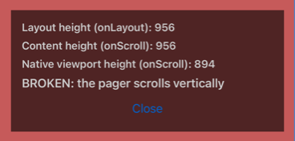
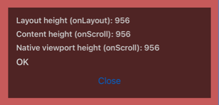

# react-native-screens: a presented formSheet resizes its recycled ScrollView

Minimal repro for a react-native-screens 4.28.0 iOS (Fabric) bug.

A `formSheet` keeps a `bounds` KVO observer on the `ScrollView` it found when it laid out. If the sheet's content removes or replaces that `ScrollView` while the sheet stays presented, Fabric recycles the instance into another screen, and the observer forces it back to the sheet's frame. Here the recycled instance becomes the pager in a full-screen `Modal`, whose native viewport ends up the sheet's height while its layout is the screen's, so the pager scrolls vertically.

| Unpatched 4.28.0 | With the suggested fix |
| --- | --- |
|  |  |

Measured on an iPhone 17 Pro Max simulator (iOS 26.2); the difference is the sheet's top inset.

## Run

```sh
npm install
npx expo run:ios
```

`EXPO_PUBLIC_AUTORUN=1 npx expo run:ios` runs the whole sequence on launch without a tap.

## Steps

1. Tap **Open sheet**. The sheet renders a `ScrollView` (`app/sheet/index.tsx`).
2. After a second the sheet replaces it with plain content and stays presented.
3. Tap **Open full-screen pager**. The overlay compares the pager's layout height (`onLayout`) with the `UIScrollView`'s real height (`layoutMeasurement` from a scroll event): **BROKEN** when they differ. Drag the pager up and down to see it scroll vertically.
